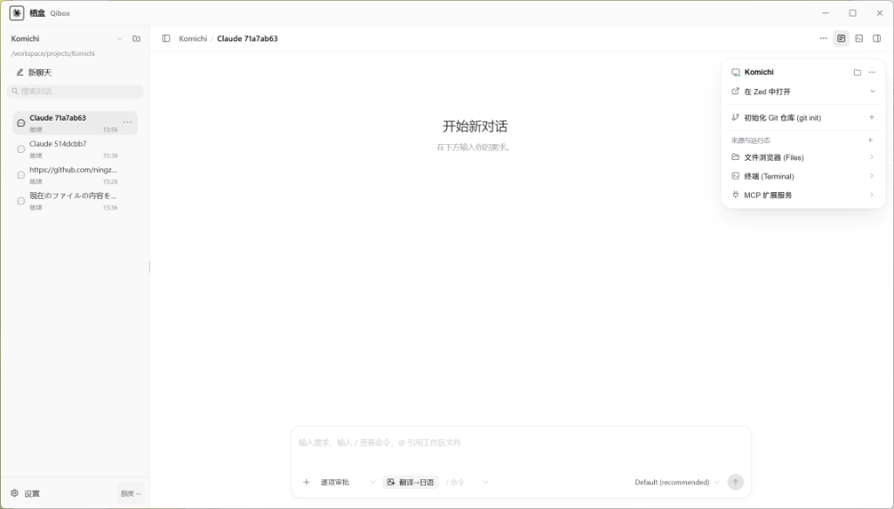

# 栖盒 Qibox

Windows 桌面上的 Claude Code 工作区。通过 WSL2 运行 Claude Code，集成项目与会话管理、双向翻译、内置终端、文件浏览与 Git 差异查看。

技术栈：Tauri (Rust) + React + TypeScript + Node.js。



## 运行要求

- **Windows**：已安装 WebView2 Runtime 与 Node.js 24（`node` 在 `PATH` 中可用）
- **WSL2**：默认使用 `Ubuntu`（需 Node.js 24、Git、Claude Code、Claude Agent SDK、`node-pty`，支持一键安装）
- **Claude**：可用的 Claude 账号或 Anthropic 兼容 API
- **翻译（可选）**：本机 Codex CLI，或任意 OpenAI 兼容 API

## 快速开始

1. **准备 WSL2**（如尚未安装）：在管理员 PowerShell 中运行 `wsl --install -d Ubuntu`，重启并初始化 Linux 用户；用 `wsl -l -v` 确认版本为 `2`。
2. **启动应用**：完整解压 `Isolation Console.zip` 到可写目录（保留同级的 `src` 与 `config`），运行 `Start-Isolation.bat`（或直接打开 `Isolation Console.exe`）。
3. **初始化环境**：进入 **设置 → 运行环境**，点击 **配置 WSL** 自动安装所需依赖（或运行目录中的 `Setup-WSL.bat`），完成后点击 **启动环境**。
4. **配置账号与翻译**：按下方说明配置后，即可新建项目并开始对话。

<details>
<summary>WSL2 手动安装与 sudo 权限排查</summary>

**sudo 权限不足**（提示不在 `sudoers` 中）：将下列 `Ubuntu` 与 `qibox` 替换为实际发行版和用户名，在 PowerShell 检查并将用户加入 `sudo` 组：

```powershell
wsl -d Ubuntu -u qibox -- sudo -l
wsl -d Ubuntu -u root -- usermod -aG sudo qibox
```

**手动安装依赖**：确保运行用户的 `/usr/local/bin:/usr/bin:/bin` 中可找到 `node`（v24）和 `claude`，并安装 `git`，然后在 WSL2 中执行：

```bash
sudo mkdir -p /opt/isolation /workspace
sudo chown "$(id -un):$(id -gn)" /opt/isolation /workspace
npm install --prefix /opt/isolation @anthropic-ai/claude-agent-sdk@0.3.323 node-pty
```

> 若 `node-pty` 需要本地编译，请额外安装 `build-essential python3`。如需在界面内直接 `git commit`，请先在 WSL2 中配置 `git config --global user.name` 与 `user.email`。

</details>

## 配置

### Claude 账号与 API

- **同步 Windows 配置**：在 **设置 → 账号与连接** 点击 **读取 Windows 配置** → **同步到 WSL2**。程序按 `CC Switch` → `CLAUDE_CONFIG_DIR` → `%USERPROFILE%\.claude` 顺序读取 `settings.json`。
  - 使用 API Key 时，在 `settings.json` 中添加 `env.ANTHROPIC_BASE_URL` 与 `env.ANTHROPIC_API_KEY`（或 `ANTHROPIC_AUTH_TOKEN`），确认 WSL2 可访问该地址。
- **账号登录**：也可直接在 WSL2 中以配置的 Linux 用户运行 `claude` 完成登录。

### 双向翻译（可选）

在 **设置 → 对话与翻译** 选择翻译方式并保存（支持按需开关，或在输入框开启「原文直发」）：

- **关闭翻译**：直接以原文对话。
- **本机 Codex**：需在 Windows 安装并登录 Codex CLI，保存后点击 **检查翻译连接**。自定义可执行文件路径可设置环境变量 `ISOLATION_CODEX_EXECUTABLE`。
- **OpenAI 兼容 API**：填写基础地址（如 `https://api.example.com/v1`，**不要**追加 `/chat/completions`）、模型 ID 与 API Key。远程接口需 HTTPS，本机允许 `http://127.0.0.1` / `localhost`。

## 数据与配置位置

| 路径                            | 说明                                                                        |
| ------------------------------- | --------------------------------------------------------------------------- |
| `config/isolation.json`         | 本机 WSL2 发行版、用户、工作目录与代理配置（基于 `isolation.example.json`） |
| `config/chat.local.json`        | 翻译偏好与 API 密钥（仅本机保存，不入库）                                   |
| `.runtime/`                     | 聊天数据库、运行状态与后台日志（`wsl-daemon.log`）                          |
| WSL2 `/workspace` & `~/.claude` | 默认项目目录、Claude 历史与会话索引                                         |

> 修改环境配置前请先停止后台服务，保存后再重新启动。

## 从源码构建

除运行要求外，还需 Git、Rust MSVC 工具链、Microsoft C++ Build Tools 与 Windows SDK。

```powershell
# 安装依赖并构建（覆盖根目录的 Isolation Console.exe，构建前请先关闭运行中的窗口）
npm ci
cd desktop
npm ci
npm run desktop:build
cd ..
```

- **开发模式**：在 `desktop/` 目录运行 `npm run desktop:dev`
- **打包发布包**（输出 `dist/Isolation Console.zip`）：

```powershell
powershell -NoProfile -ExecutionPolicy Bypass -File scripts/package-release.ps1
```

## LINUX DO 社区

感谢 [Linux.do](https://linux.do) 社区的支持与贡献。

## 许可证

[MIT](LICENSE)
